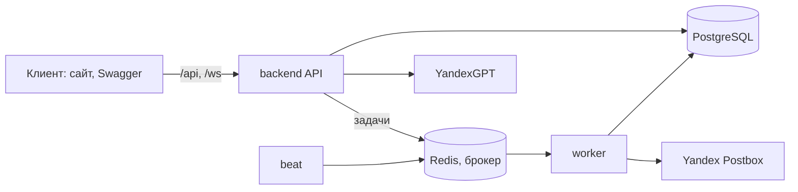
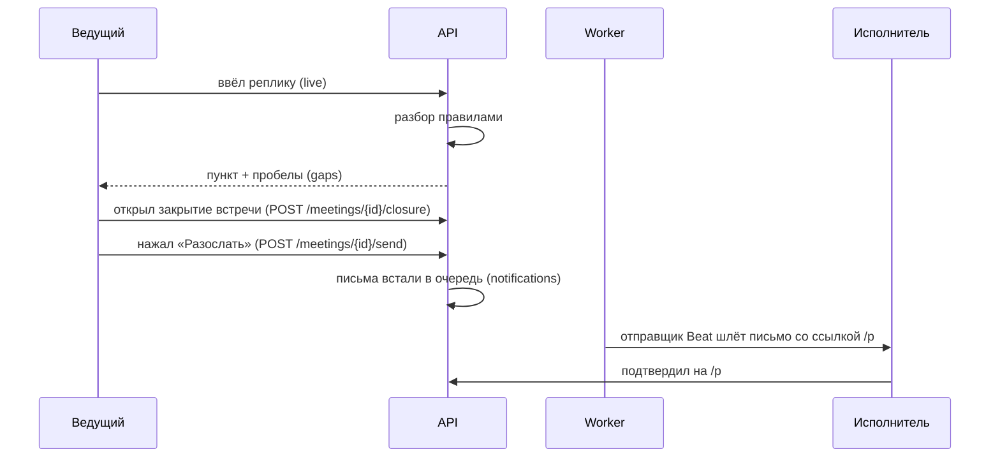
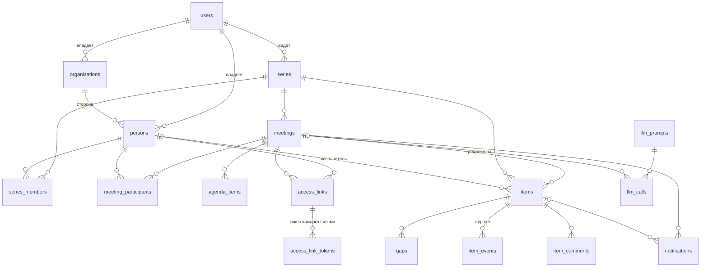

# Архитектура

Вся логика в одном backend-приложении (FastAPI) с модулями; фоновые задачи (письма, напоминания, чистка) идут через Celery. Клиент (сайт, Swagger, curl) ходит в API по HTTP и WebSocket. Фронтенд в этот репозиторий не входит.

## Модули `backend/app/modules/`
- `auth` вход, JWT в httpOnly-cookie.
- `series` серии регулярных встреч.
- `items` пункты: что, кто, срок, критерий, статус.
- `live` встреча в реальном времени (ввод пунктов, веб-сокет).
- `gaps` поиск пробелов в пункте (нет срока, нет ответственного).
- `llm` клиент YandexGPT (`LLMClient`), заглушка без ключа.
- `confirm` подтверждение пункта исполнителем по ссылке `/p`.
- `notifications` письма и напоминания: очередь, отправщик Beat (повторы, слияние, лимит), Postbox, без ключа только лог.
- `analytics` события продукта и выгрузка CSV.
- `health` проба живости.

## Слои внутри модуля
`router.py` (HTTP: разбор запроса, коды ответа) → `service.py` (правила предметной области, транзакция) → `repository.py` (запросы SQLAlchemy). Роутер не ходит в базу, репозиторий не знает про HTTP. Так требует SRS. Рядом `schemas.py` (контракт API), `models.py` (таблицы), `tasks.py` (задачи Celery); если слою в модуле нечего делать, файла нет.

## Путь одного решения

Уточнение разбора через LLM (`enrich_item`) в этот путь пока не подключено. Страница исполнителя `/p/{token}` работает без входа: доступ по ссылке из письма, в базе только отпечаток токена.

## Модель данных
17 таблиц SRS v3 и 3 служебные (`login_attempts`, `password_reset_tokens`, `access_link_tokens`). Типы данных, ограничения в БД, правила удаления и сверка с ERD аналитиков — в [db/README.md](../db/README.md). Модели лежат в `app/modules/<модуль>/models.py`, реестр для Alembic — `app/models.py`.

- `items`: статус `draft → pending/accepted → done`, `disputed`, `cancelled`; просрочка вычисляется. `version` для `If-Match`.
- `access_links` / `access_link_tokens`: токены ссылки случайные, хранятся только SHA-256 (UNIQUE); у письма свой токен, все они действуют, пока жива ссылка (FR-30).

## Режим разработки
Служебное (`/auth/token`, демо-данные, `app.demo`) включает только `DEV_MODE`, по умолчанию он выключен; подробности — в «Быстром старте» и «Развёртывании на сервере» корневого [README](../README.md).

## Запуск и проверки
- `compose.yaml`: db (PostgreSQL 16), redis, backend (миграции при старте, порт 8000), worker и beat (Celery). Подробно — README.
- На сервере перед API стоит обратный прокси (nginx): HTTPS и лимит 30 запросов в минуту с одного IP для `/p` (NFR-10). Его настройка в этот репозиторий не входит; лимиты входа (FR-02) держит само API.
- CI и публикация образа в GHCR — [`.github/workflows/ci.yml`](../.github/workflows/ci.yml) и `release.yml`.
